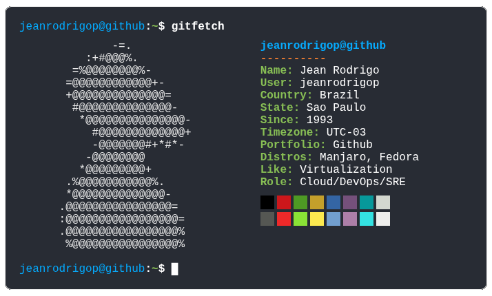

<h1 align="center">Hello, Git!</h1>

  <strong>SysAdmin → DevOps Engineer</strong> 
  Infrastructure · Automation · Cloud · Observability

  
  

---

## About Me

Systems administrator transitioning into DevOps, with a background in operating and supporting Linux, Windows and BSD environments. My focus is on building reliable, observable and automated infrastructure, applying Infrastructure as Code, containerization and cloud-native practices.

- 🛠️ **Background:** system administration, monitoring and infrastructure operations
- ☁️ **Focus:** cloud platforms, containers, Kubernetes and Infrastructure as Code
- 📈 **Approach:** continuous learning — study, practice, apply, understand

---

## Tech Stack

![Linux][badge-linux] ![Windows][badge-windows] ![FreeBSD][badge-bsd] ![MacOS][badge-mac] ![AWS][badge-aws] ![Azure][badge-azure] ![Docker][badge-docker] ![Kubernetes][badge-k8s] ![Helm][badge-helm] ![Terraform][badge-terraform] ![Zabbix][badge-zabbix] ![Grafana][badge-grafana] ![Elastic][badge-elastic] ![Bash][badge-bash] ![Git][badge-git] ![GitHub][badge-github] ![GitLab][badge-gitlab] ![Vim][badge-vim] ![VSCode][badge-vscode]

---

## GitHub Activity

  
    
  
  
   
  

---

  Always open to connect and exchange knowledge about infrastructure, automation and DevOps culture.

<!-- Badges -->
[badge-linux]: https://img.shields.io/badge/-Linux-0a0a0a?style=flat-square&logo=linux&logoColor=white
[badge-bsd]: https://img.shields.io/badge/-FreeBSD-a53232?style=flat-square&logo=freebsd&logoColor=white
[badge-mac]: https://img.shields.io/badge/-MacOS-696969?style=flat-square&logo=apple&logoColor=white
[badge-aws]: https://img.shields.io/badge/-AWS-e39f3d?style=flat-square&logoColor=white&logo=icloud
[badge-docker]: https://img.shields.io/badge/-Docker-4672d8?style=flat-square&logo=docker&logoColor=white
[badge-k8s]: https://img.shields.io/badge/-Kubernetes-516EC3?style=flat-square&logo=kubernetes&logoColor=white
[badge-helm]: https://img.shields.io/badge/-Helm-1C1F70?style=flat-square&logo=helm&logoColor=white
[badge-terraform]: https://img.shields.io/badge/-Terraform-7A59A1?style=flat-square&logo=terraform&logoColor=white
[badge-zabbix]: https://img.shields.io/badge/-Zabbix-e54545.svg?style=flat-square&logoColor=white
[badge-grafana]: https://img.shields.io/badge/-Grafana-e18751?style=flat-square&logo=grafana&logoColor=white
[badge-elastic]: https://img.shields.io/badge/-Elastic-374E66?style=flat-square&logo=elastic&logoColor=white
[badge-bash]: https://img.shields.io/badge/-Bash-0a0a0a?style=flat-square&logo=gnubash&logoColor=white
[badge-git]: https://img.shields.io/badge/-Git-e46c56?style=flat-square&logo=git&logoColor=white
[badge-github]: https://img.shields.io/badge/-GitHub-0a0a0a?style=flat-square&logo=github&logoColor=white
[badge-gitlab]: https://img.shields.io/badge/-GitLab-F56A24?style=flat-square&logo=gitlab&logoColor=white
[badge-vim]: https://img.shields.io/badge/-Vim-3c9b5d?style=flat-square&logo=vim&logoColor=white
[badge-actions]: https://img.shields.io/badge/-GitHub_Actions-5987DC?style=flat-square&logo=githubactions&logoColor=white
[badge-ansible]: https://img.shields.io/badge/-Ansible-000000?style=flat-square&logo=ansible&logoColor=white
[badge-python]: https://img.shields.io/badge/-Python-356C99?style=flat-square&logo=python&logoColor=white
[badge-go]: https://img.shields.io/badge/-Golang-01A6D1?style=flat-square&logo=go&logoColor=white
[badge-rust]: https://img.shields.io/badge/-Rust-DC3519?style=flat-square&logo=rust&logoColor=white
<!-- Base64 Badges -->
[badge-windows]: https://img.shields.io/badge/-Windows-4672d8.svg?style=flat-square&logoColor=white&logo=
[badge-azure]: https://img.shields.io/badge/-Azure-4672d8.svg?style=flat-square&logoColor=white&logo=
[badge-vscode]: https://img.shields.io/badge/-VSCode-4672d8.svg?style=flat-square&logoColor=white&logo=
<!-- Base64 Badges End -->
